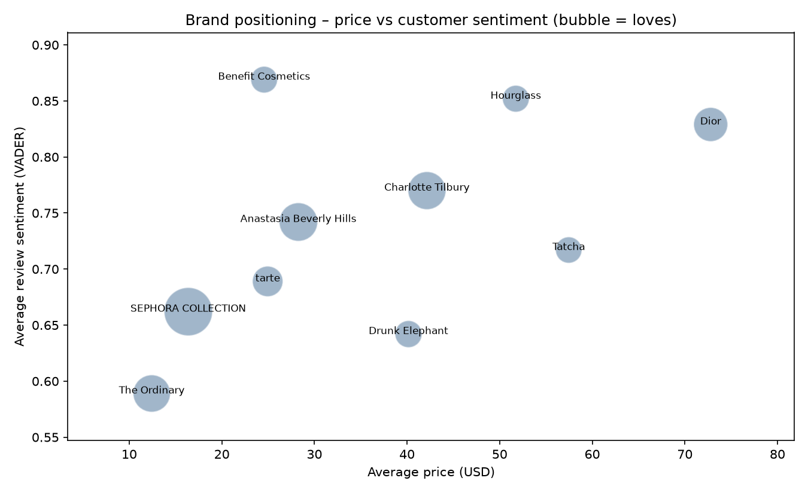
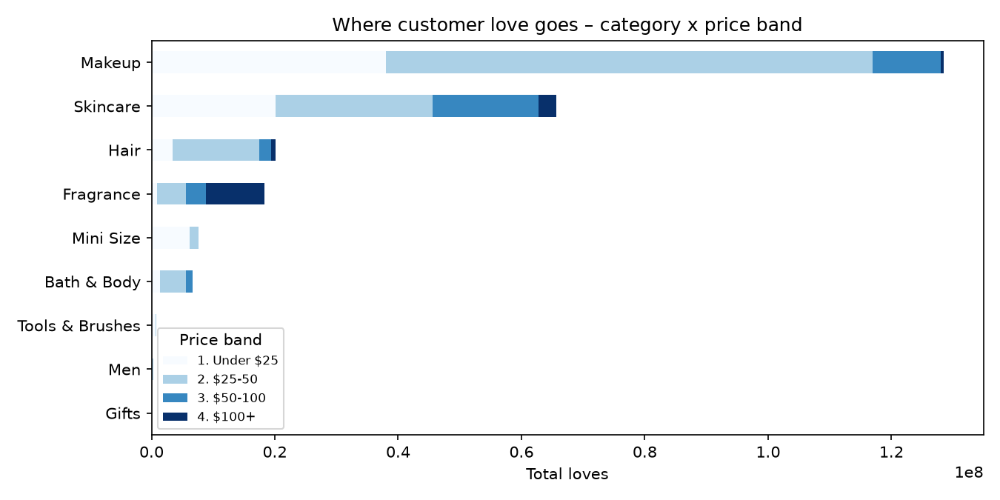
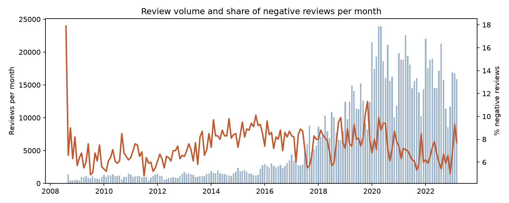

# Beauty Analytics Pipeline – Sephora Products & Reviews

End-to-end data pipeline that turns raw Sephora product and review data into a tested data warehouse and a Power BI dashboard on brands, categories, pricing and customer sentiment.

**Business questions**
- Which brands and categories do customers love most, and at what price?
- Which brands generate the most negative reviews?
- Which well-rated products deserve more visibility?

## Architecture

```
CSV files (Kaggle)
   │  extract_load.py   – schema validation, cleaning, load
   ▼
PostgreSQL  raw.*  ──► sentiment.py (VADER) ──► raw.review_sentiment
   │
   ▼  dbt  (staging views → star-schema marts, 22 data tests)
PostgreSQL  marts.*  ──► Power BI dashboard
                     └─► export_marts.py (CSV)  /  dashboard_preview.py (PNG + insights)

Orchestration: Apache Airflow, weekly – extract_load → sentiment → dbt run → dbt test → export
```

## Results

> Run the pipeline on the real dataset, then replace this block with the numbers from `dashboard/insights.md` and your Power BI screenshots.

- _X_ products, _X_ reviews processed
- **_Category_** is the most loved category
- **_Brand_** has the highest recommendation rate; **_Brand_** the highest share of negative reviews
- _X_ "hidden gems": top 10% sentiment but below-median popularity





## Data model (dbt)

| Layer | Model | Grain / content |
|---|---|---|
| staging | `stg_products` | one product: typed columns, effective price, price band |
| staging | `stg_reviews` | one review + sentiment score and label |
| marts | `dim_products` | product dimension + review KPIs + popularity rank |
| marts | `fct_reviews` | review fact table, joined to product attributes |
| marts | `mart_brand_performance` | brand scorecard (price, loves, rating, sentiment, recommendation) |
| marts | `mart_category_summary` | category × price band |
| marts | `mart_monthly_reviews` | monthly trend by category |

Data quality: uniqueness and not-null keys, accepted values for ratings and sentiment labels, referential integrity between facts and dimensions. In Airflow, the export only runs if every test passes.

## Project structure

```
beauty-data-pipeline/
├── dags/sephora_pipeline.py      # Airflow DAG
├── docker/docker-compose.yml     # PostgreSQL + Airflow
├── dbt/                          # dbt project (models, tests, profiles)
├── src/
│   ├── extract_load.py           # extract, validate, load raw tables
│   ├── sentiment.py              # VADER sentiment scoring
│   ├── export_marts.py           # marts → CSV for Power BI
│   ├── dashboard_preview.py      # static charts + computed insights
│   └── generate_sample_data.py   # synthetic data for testing
├── dashboard/POWERBI_GUIDE.md    # step-by-step Power BI build (model, DAX, pages)
├── run_local.sh                  # full run on DuckDB, without Docker
├── run_local.ps1                 # same, for Windows PowerShell
└── requirements.txt
```

## How to run

**1. Get the data** – download "Sephora Products and Skincare Reviews" from Kaggle
(https://www.kaggle.com/datasets/nadyinky/sephora-products-and-skincare-reviews) and copy `product_info.csv` and all `reviews_*.csv` files into `data/`.

**2a. Full stack with Docker (PostgreSQL + Airflow)**
```bash
docker compose -f docker/docker-compose.yml up -d
# open http://localhost:8080 and trigger the "sephora_beauty_pipeline" DAG
```

**2b. Quick local run without Docker (DuckDB)**
```bash
pip install -r requirements.txt
./run_local.sh
```
On Windows (PowerShell):
```powershell
python -m venv .venv
.\.venv\Scripts\python.exe -m pip install -r requirements.txt
.\run_local.ps1
```
Each run starts from a fresh `sephora.duckdb`.

**3. Dashboard** – follow [`dashboard/POWERBI_GUIDE.md`](dashboard/POWERBI_GUIDE.md).

To test without the real data: `python src/generate_sample_data.py`, then step 2b.

## Tools

Python (pandas, SQLAlchemy, vaderSentiment), PostgreSQL, dbt, Apache Airflow, Docker, Power BI, DuckDB

## Limits

- The dataset has no sales figures: popularity is measured with "loves" and review volume.
- VADER is a lexicon model for English; a fine-tuned transformer would capture nuance better.
